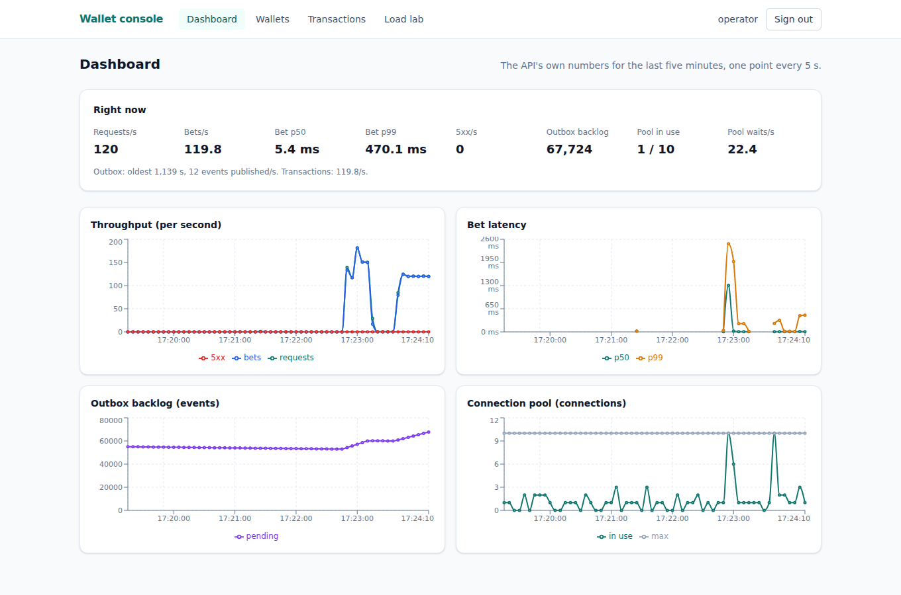
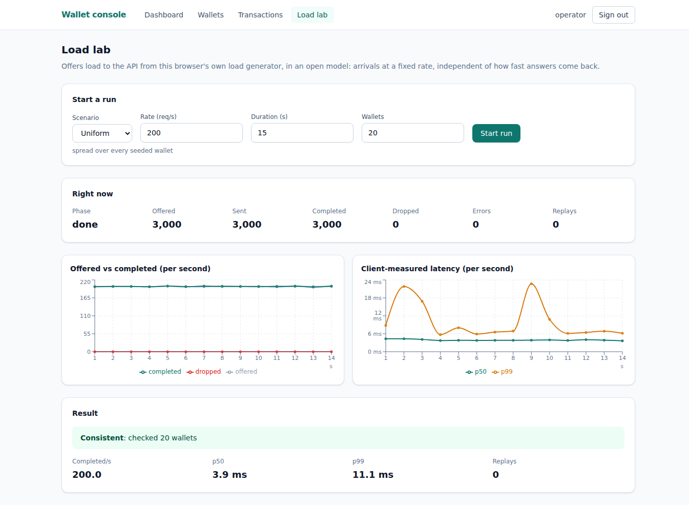

# go-high-load-wallet console

[](https://github.com/Ricardoleaom/go-high-load-wallet-web/actions/workflows/ci.yml)

An operator console for [go-high-load-wallet](https://github.com/Ricardoleaom/go-high-load-wallet):
sign in through the wallet's Keycloak, watch wallets, transactions,
ledgers and reconciliation, follow the service live, and put it under
real load from a server-side load generator that checks the money
against what the backend actually did.





## Layout

| Path | What |
| --- | --- |
| `web/` | the single-page console: React, TypeScript, Vite |
| `web/openapi.yaml` | the backend's API contract, copied at a recorded commit by `web/scripts/sync-openapi.sh` |
| `loadlab/` | the load generator: an open-model Go service, behind its own HTTP API |
| `compose.yaml` | builds and runs `web` and `loadlab` beside the backend's own stack |

## Develop

The backend must be running first (`POSTGRES_HOST_PORT=55432 make up` in
go-high-load-wallet), with the console's origins allowed (its Compose
file does that by default).

```sh
cd web
npm ci
npm run dev        # http://localhost:5173, sign in as operator / operator
npm test
```

```sh
cd loadlab
go test -race ./...
go run ./cmd/loadlab   # :8090, points at the backend's local defaults
```

## Run as containers

With the backend's own stack up:

```sh
docker compose up --build
```

This builds and starts:

- `web`, the console served by nginx, at <http://localhost:8088>;
- `loadlab`, on the backend's Docker network so it reaches the API and
  Keycloak directly, published at <http://localhost:8090>.

`docker compose down` stops both; it never touches the backend's own
stack.

## Testing

```sh
cd web
npx playwright install chromium   # once
npm run e2e
```

End to end tests ([`web/e2e/`](web/e2e/)) run against the real backend
and load lab — both must already be up — through a built, served console
(`playwright.config.ts` runs `npm run build && npm run preview`). Each
spec also scans its page with `@axe-core/playwright` and fails on any
`serious` or `critical` accessibility violation. They cover: sign in and
out; opening a wallet, seeing its detail and reconciling it; following a
ledger entry to its transaction; the dashboard filling in with points
once traffic flows; and a short load lab run whose money checks out.

## The first real load

Run 2026-10-19, against go-high-load-wallet at
[`ea5fb7c`](https://github.com/Ricardoleaom/go-high-load-wallet/commit/ea5fb7c)
(phase 2b, one statement per command) through the load lab's own HTTP
API, on the same unpinned WSL2 laptop as the backend's own benchmarks.
Unlike those benchmarks ([ADR 0009](https://github.com/Ricardoleaom/go-high-load-wallet/blob/master/docs/adr/0009-benchmark-methodology.md)),
nothing here is CPU-pinned and the machine was shared with the rest of
this development session, so these numbers are a demonstration, not a
replacement for [benchmark 004](https://github.com/Ricardoleaom/go-high-load-wallet/blob/master/docs/benchmarks/004-single-statement-hot-path.md) — they land in the same range anyway.

**300 rps for 20 s** (`uniform`, 200 wallets) — comfortably inside the
backend's own knee: 6,000/6,000 completed, 0 dropped, 0 errors, all
`200`. The load lab's own client-measured p50 was 4.3 ms; the server's
`/ops/summary` panel stayed under a 10–80 ms p99 the whole run, pool
usage 2–3 of 10 connections. Verification: 200 wallets checked, passed.

**1,000 rps for 60 s** (`uniform`, 500 wallets) — well past it, on
purpose: offered 60,000, sent 49,143 (the load lab itself started
shedding arrivals past its 4,096 in-flight cap once the backend stopped
draining them fast enough), every one of those answered (0 network
errors). Of the 49,143 answers, 23,438 were `200` and 25,705 were `503
TIMEOUT` — the backend's own time budget ([ADR 0012](https://github.com/Ricardoleaom/go-high-load-wallet/blob/master/docs/adr/0012-time-budgets-and-input-limits.md))
shedding what it could not finish. The server panel topped out at about
**822 completed bets a second**, pool fully saturated (10/10) with 74–179
waits a second — the same ceiling [benchmark 004](https://github.com/Ricardoleaom/go-high-load-wallet/blob/master/docs/benchmarks/004-single-statement-hot-path.md)
found (about 970–1,020 rps on its own, pinned run), reached here without
pinning and under a busier machine. Latency past that point grew well
beyond any single request's own 5 s budget — consistent with [benchmark
004's finding](https://github.com/Ricardoleaom/go-high-load-wallet/blob/master/docs/benchmarks/004-single-statement-hot-path.md#analysis)
that nothing sheds excess load early yet (phase 2c's admission control is
next). Verification: **500 wallets checked, 0 mismatches, passed** —
every bet the backend actually processed, including the 25,705 it shed,
left the books exactly where the load lab expected.
